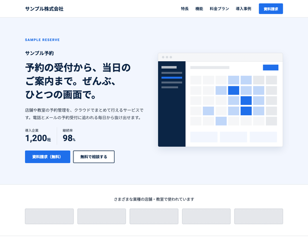

# BcLpServiceTheme

baserCMS5用の、BtoB のサービス（クラウドサービス・SaaS、士業、制作会社など）の紹介と、資料請求・無料相談のための1ページ LP（ランディングページ）テーマです。
お悩み・特長・機能・料金プランと比較表・導入事例・導入の流れ・資料請求フォームまでを、
BurgerEditor のブロック操作と管理画面の設定だけで編集できます。

## 主な機能

- **1ページ LP**：トップの固定ページ1枚に、セクションを BurgerEditor のブロックで並べる構成
  - ヒーロー／導入企業のロゴ／こんなお悩みはありませんか／特長／機能／料金プラン（比較表）／導入事例／導入の流れ／よくある質問／資料請求・無料相談（CTA）
  - セクションの追加・削除・並べ替えは、ブロック操作だけでできる
- **ページ内ナビの自動生成**：大見出しブロックの「ID設定」に英字（例 `features`）を入れると、ヘッダーのナビに載る。
  見出しの上には ID から作った英字のラベル（`FEATURES`）が出る
- **資料請求・無料相談フォーム**：入力 → 確認 → 完了の3画面。項目は管理画面のメールフィールドで追加・並べ替えできる
  - 「資料請求」「無料で相談する」のボタンから開くと、ご用件が選ばれた状態になる
  - 料金プランのボタンから開くと、そのプランも選ばれた状態になる（どのプランから問い合わせがあったかがわかる）
- **料金プラン**：「おすすめ」と書いたプランは、枠が太くなりボタンがメインの色になる。金額の数字は自動で大きくなる
- **テーマ設定の4色**で全体の配色が変わる（メイン／サブ／リンク／ホバー）。どの色にしても文字が読みやすいよう、文字の濃さと白黒を自動で調整する。ロゴもテーマ設定で変更できる
- **初期データ**：見本サイト一式（`default`）と、最小構成（`empty`）
- レスポンシブ（PC／スマホ）、`prefers-reduced-motion` 対応

## 動作環境

- baserCMS5.4以上
- BurgerEditor（BcBurgerEditor）プラグインが有効であること

## インストール

1. `plugins/BcLpServiceTheme` に配置
2. 管理画面 > プラグイン管理 で BcBurgerEditor が有効になっていることを確認
3. 管理画面 > テーマ管理 で BcLpServiceTheme を適用
4. 同じ画面で初期データ `default`（見本サイト）または `empty`（最小構成）を読み込む

> 初期データを読み込むと、ユーザー以外のデータ（固定ページ・メールフォーム・サイト基本設定など）は初期化されます。
> 運用中のサイトでは読み込まないでください。

## 使い方

### 編集できる場所

| 内容 | 編集する場所 |
|---|---|
| 本文（全セクション） | 固定ページ「トップページ」の BurgerEditor |
| ロゴ・配色 | テーマ設定 |
| ヘッダーのナビ | 本文の大見出しブロックの「ID設定」（自動で作られる） |
| ヘッダーの「資料請求」ボタンのリンク先 | 自動（公開中の最初のメールフォーム） |
| フォームの説明文・完了メッセージ・項目 | メールフォームの設定・メールフィールド |
| フッター（会社名・所在地・問い合わせ先・利用規約などのリンク） | ウィジェットエリア「フッター」のテキストウィジェット |

### 本文ブロックの独自 class

ブロック設定の「独自class設定」に入れると、決まった見た目になります。
一覧と中身の書き方は `webroot/css/bge_style.css` の冒頭にあります。

| 独自 class | 使うブロック | 見た目 |
|---|---|---|
| `sv-blk--hero` | 画像右寄せ（テキスト回り込み無し） | ヒーロー（英字・サービス名・キャッチ・紹介文・実績・ボタン2つ。画像が空なら画面のイメージを描く） |
| `sv-blk--logos` | 画像5列 | 導入企業のロゴ |
| `sv-blk--section` | 大見出し | セクション見出し（中央寄せ。ID 設定でナビと英字ラベル） |
| `sv-blk--nonav` | 大見出し（`sv-blk--section` と併用） | ナビに載せない |
| `sv-blk--lead` | 1カラムテキスト | 見出しの下のリード文 |
| `sv-blk--problems` | 1カラムテキスト | お悩みのカード（アイコンは並び順） |
| `sv-blk--features` | 画像3列＋テキスト | 特長のカード（「POINT 01」は自動） |
| `sv-blk--functions` | 1カラムテキスト | 機能のカード（アイコンは並び順） |
| `sv-blk--plans` | 画像3列＋テキスト | 料金プランのカード（画像は表示しない） |
| `sv-blk--compare` | 1カラムテキスト | プランの比較の表（CKEditor の表） |
| `sv-blk--note` | 1カラムテキスト | 小さな注記 |
| `sv-blk--cases` | 画像3列＋テキスト | 導入事例のカード |
| `sv-blk--steps` | 1カラムテキスト | 導入の流れ（番号付きリスト。「STEP 1」は自動） |
| `sv-blk--faq` | 1カラムテキスト | よくある質問（開閉式。最初はすべて閉じる） |
| `sv-blk--cta` | 1カラムテキスト | 資料請求・無料相談の CTA（背景色「ピンク」と組み合わせる） |
| `sv-blk--center` | 任意 | 中央寄せ |

ブロック設定の「背景色」は、テーマ色に置き換えています（ブルー＝メインの薄い色／グレー＝サブの薄い色・上下に線／ピンク＝サブの濃い色・白い文字）。

### 料金プランの書き方

画像3列＋テキストのブロック（`sv-blk--plans`）の各列に、次の順で書きます。画像の欄は表示されません。

1. 段落「おすすめ」（省略できる。書いたプランは枠が太くなり、ボタンがメインの色になる）
2. 見出し3：プラン名
3. 段落：`月額 3,000円`（最初の数字が大きくなる）
4. 段落：おすすめの対象
5. 箇条書き：主な内容
6. 最後の段落にリンク：ボタン

### フォームを、項目を選んだ状態で開くリンク

`/contact/?purpose=6LOH5paZ6KuL5rGC&plan=44K544K-44Oz44OA44O844OJ` のように、メールフォームの URL に
`?フィールド名=値` を付けると、その値が選ばれた状態でフォームが開きます（baserCMS のメールフォームの機能）。
値は baserCMS 独自の URL 用 base64（`base64_encode` の結果の `+`→`_`、`/`→`-`、`=`→`.`）にします。

| 選ぶ値 | リンクに付ける文字列 |
|---|---|
| ご用件：資料請求 | `purpose=6LOH5paZ6KuL5rGC` |
| ご用件：無料相談 | `purpose=54Sh5paZ55u46KuH` |
| プラン：ライト | `plan=44Op44Kk44OI` |
| プラン：スタンダード | `plan=44K544K-44Oz44OA44O844OJ` |
| プラン：プロ | `plan=44OX44Ot` |

プラン名やご用件の選択肢の文言を変えたときは、メールフィールドの選択肢とリンクの両方を直してください。

### 複数の場所に書かれている値を変えるとき

次の値は複数の場所に書かれているので、それぞれ直してください。

- **料金**：料金プラン（`sv-blk--plans`）／プランの比較（`sv-blk--compare`）／よくある質問
- **プラン名**：料金プラン／プランの比較／メールフィールド「検討中のプラン」の選択肢／料金プランのボタンのリンク
- **サービス名・会社名**：ヒーロー／フッター（ウィジェット）／メールフォームの差出人名・件名／テーマ設定のロゴの代替テキスト
- **無料トライアルの日数**：料金の注記（`sv-blk--note`）／導入の流れ／よくある質問

### 配色の例

初期色はネイビーです。テーマ設定の4色を変えると、次のような配色にできます。

| | 初期色（ネイビー） | 配色例（青紫） | 配色例（ティール） |
|---|---|---|---|
| メイン | `#1f6feb` | `#5b5bd6` | `#0ea5a4` |
| サブ | `#0b2545` | `#1e1b4b` | `#13343b` |
| リンク | `#1f6feb` | `#4f46e5` | `#0b8584` |
| ホバー | `#154ab0` | `#3730a3` | `#08605f` |

## 制限事項

- 料金・プラン名などは各ブロックに直接書くため、変更時は複数の場所を直す必要があります（上記「複数の場所に書かれている値を変えるとき」）
- 導入企業のロゴは、画像5列のブロックで5つまで並べられます。6つ以上にするときは、ブロックを追加してください（行が分かれます）
- 「お悩み」「機能」のアイコンは項目ごとに選べません。並び順で決まります
- ヒーローの画像が空のときに出る画面のイメージは、CSS で描いた簡易的なものです。実際のスクリーンショットを登録して使ってください

## 同梱物・外部リソース

| 名前 | 用途 | ライセンス |
|---|---|---|
| [jQuery](https://jquery.com/) 3.7.1（`webroot/js/vendor/`） | BurgerEditor の公開側スクリプト（地図・YouTube・画像ポップアップ）の動作に必要 | MIT |
| [Google Fonts](https://fonts.google.com/)（Noto Sans JP・Roboto） | 本文・見出し・英数字のフォント（CDN から読み込み。同梱はしていない） | SIL Open Font License 1.1 |
| アイコン（`bge_style.css`・テンプレート内の SVG） | お悩み・機能・料金プラン・FAQ などのアイコン | [Lucide](https://lucide.dev/) のアイコンをもとにしている（ISC License） |

## ライセンス

MIT License
